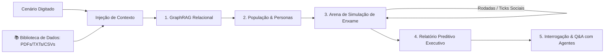

# 🔮 Prevision AI — Motor de Previsão de Inteligência de Enxame

Plataforma preditiva em Python baseada em **Inteligência de Enxame (*Swarm Intelligence*)**, **GraphRAG relacional**, **Biblioteca de Dados / Repositório de Documentos** e **simulação multiagente**.

---

## 🚀 Como Funciona a Tecnologia

Em vez de depender de um único modelo de linguagem respondendo como um "oráculo", o Prevision instancia um ambiente digital simulado com centenas de agentes autônomos que interagem e reagem a cenários reais e a documentos de negócio:



1. **Biblioteca de Dados (`document_store.py`):** Permite subir e armazenar permanentemente relatórios em PDF, TXT, MD ou CSV. Durante a simulação, você pode selecionar manualmente quais dados incluir ou deixar o motor selecionar os documentos relevantes por afinidade de palavras-chave.
2. **Ingestão & GraphRAG (`graph_rag.py`):** Extrai entidades de mercado (consumidores, concorrentes, reguladores, tomadores de decisão) e relações de causa/efeito para construir um grafo relacional (`NetworkX`).
3. **Gerador de População (`persona_generator.py`):** Instancia agentes com perfis psicológicos completos (aversão ao risco, sensibilidade a preço, ceticismo, poder de influência social e viés inicial).
4. **Motor de Enxame (`simulation_engine.py`):** Executa rodadas discretas onde agentes publicam, reagem, curtem, boicotam e atualizam seus sentimentos por contágio social.
5. **Relatório Preditivo Executivo (`report_agent.py`):** Calcula a probabilidade matemática de sucesso, índice de risco, grau de polarização e formula recomendações estratégicas mitigatórias.
6. **Oráculo & Interrogação:** Permite fazer perguntas analíticas para a simulação ou entrevistar personas específicas em primeira pessoa.

---

## 💻 Como Executar

### 1. Interface Gráfica Interativa (Streamlit)
```bash
./venv/bin/streamlit run web_app.py
```
O painel abrirá em `http://localhost:8501`, oferecendo:
* 🎯 **1. Cenário & Simulação:** Digitação livre de cenários e seleção de documentos da biblioteca.
* 📚 **2. Biblioteca de Dados:** Upload de arquivos PDF, TXT, CSV e gestão de documentos salvos.
* 🕸️ **3. Grafo (GraphRAG):** Tabelas e nós relacionais mapeados.
* 👥 **4. Enxame de Agentes:** Cartões com o perfil psicológico de cada persona.
* 📱 **5. Feed Social Simulado:** Postagens, curtidas e sentimentos em tempo real rodada a rodada.
* 📊 **6. Relatório Preditivo:** Métricas chave, gráficos temporais e exportação em Markdown.
* 💬 **7. Interrogar o Mundo:** Chat com o oráculo analista ou entrevista com agentes.

---

### 2. Linha de Comando (CLI)
```bash
./venv/bin/python cli.py --scenario "Lançamento de plano anual com 30% de desconto" --agents 15 --rounds 3
```

---

### 3. Testes Automatizados
```bash
./venv/bin/python test_engine.py
```
