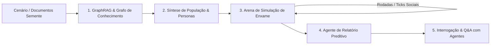

# 🐟 MiroFish Engine — Motor de Previsão de Inteligência de Enxame

Uma réplica modular e extensível em Python da tecnologia do **MiroFish** (`666ghj/MiroFish`), o motor open-source de previsão baseado em **Inteligência de Enxame (*Swarm Intelligence*)**, **GraphRAG** e **simulação multiagente**.

---

## 🚀 Como Funciona a Tecnologia

Em vez de depender de um único modelo de linguagem respondendo como um "oráculo", o MiroFish instancia um ambiente digital simulado com centenas de agentes autônomos que interagem e reagem a cenários reais:



1. **Ingestão & GraphRAG (`graph_rag.py`):** Extrai entidades de mercado (consumidores, concorrentes, reguladores, tomadores de decisão) e relações de causa/efeito para construir um grafo relacional (`NetworkX`).
2. **Gerador de População (`persona_generator.py`):** Instancia agentes com perfis psicológicos completos (aversão ao risco, sensibilidade a preço, ceticismo, poder de influência social e viés inicial).
3. **Motor de Enxame (`simulation_engine.py`):** Executa rodadas discretas onde agentes publicam, reagem, curtem, boicotam e atualizam seus sentimentos por contágio social.
4. **Relatório Preditivo Executivo (`report_agent.py`):** Calcula a probabilidade matemática de sucesso, índice de risco, grau de polarização e formula recomendações estratégicas mitigatórias.
5. **Oráculo & Interrogação:** Permite fazer perguntas analíticas para a simulação ou entrevistar personas específicas em primeira pessoa.

---

## 📦 Instalação e Configuração

O projeto já conta com um ambiente virtual configurado em `venv/`.

### 1. Variáveis de Ambiente e Chaves de API
Copie ou edite o arquivo `.env`:
```bash
cp .env.example .env
```

Selecione o seu provedor preferido no `.env`:
* **OpenAI:** `OPENAI_API_KEY=sk-...` (modelo `gpt-4o-mini` ou `gpt-4o`)
* **Google Gemini:** `GEMINI_API_KEY=AIza...` (modelo `gemini-1.5-flash`)
* **Anthropic Claude:** `ANTHROPIC_API_KEY=sk-ant-...` (modelo `claude-3-5-haiku-20241022`)
* **Groq:** `GROQ_API_KEY=gsk_...` (modelo `llama-3.3-70b-versatile`)
* **Ollama (100% Local / Gratuito):** `LLM_PROVIDER=ollama` com `OLLAMA_MODEL=llama3.2`

> 💡 **Modo Simulação Sem Chave:** Se nenhuma chave for informada, o motor executa automaticamente em modo de simulação estruturada realista, permitindo testar toda a interface e fluxo sem custos.

---

## 💻 Como Executar

### 1. Interface Gráfica Interativa (Streamlit)
Para abrir o painel completo no seu navegador:

```bash
./venv/bin/streamlit run web_app.py
```
O painel abrirá automaticamente em `http://localhost:8501`, oferecendo:
* 🎯 **Cenário Semente:** Seleção de cenários prontos ou inserção de textos/políticas customizadas.
* 🕸️ **Grafo (GraphRAG):** Tabelas e visualização das entidades e relações de mercado.
* 👥 **Enxame de Agentes:** Cartões com o perfil psicológico e postura de cada persona.
* 📱 **Feed Social Simulado:** Postagens, curtidas e sentimentos em tempo real rodada a rodada.
* 📊 **Relatório Preditivo:** Métricas chave, gráficos temporais e exportação em Markdown.
* 💬 **Interrogar o Mundo:** Chat com o oráculo analista ou entrevista individual com qualquer agente.

---

### 2. Linha de Comando (CLI)
Para rodar simulações rápidas e automatizadas via terminal:

```bash
./venv/bin/python cli.py --scenario "Reajuste de 20% no plano de internet residencial" --agents 15 --rounds 3
```

Parâmetros disponíveis:
* `--scenario`: Texto descritivo da decisão ou cenário.
* `--agents`: Quantidade de personas de IA (padrão: 12).
* `--rounds`: Quantidade de rodadas de debate (padrão: 3).
* `--provider`: Provedor a usar (`openai`, `gemini`, `anthropic`, `groq`, `ollama`).

---

### 3. Testes Automatizados
Para rodar a suíte de testes de integridade:

```bash
./venv/bin/python test_engine.py
```

---

## 📂 Estrutura de Arquivos

* `config.py`: Gestão de configurações e chaves de API.
* `llm_client.py`: Camada de comunicação unificada com LLMs (OpenAI, Gemini, Claude, Groq, Ollama) com fallback inteligente.
* `graph_rag.py`: Módulo de extração de entidades e criação do grafo de conhecimento.
* `persona_generator.py`: Síntese estatística de personas psicológicas heterogêneas.
* `simulation_engine.py`: Motor de simulação de enxame, feed social e métricas de polarização.
* `report_agent.py`: Agente executivo de síntese preditiva e modo de interrogação.
* `web_app.py`: Interface de usuário interativa em Streamlit.
* `cli.py`: Executável de linha de comando.
* `test_engine.py`: Testes unitários do pipeline completo.
